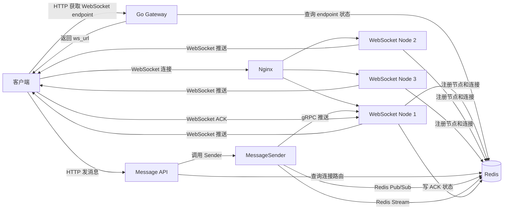
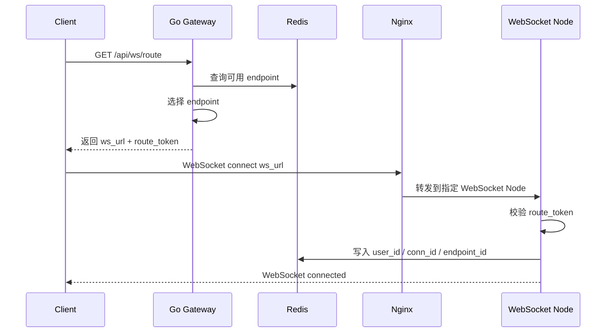
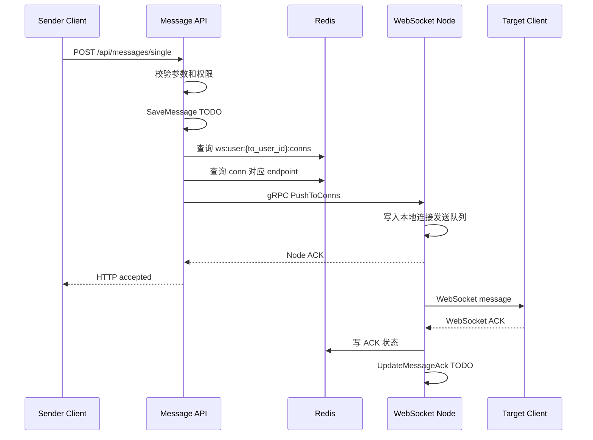
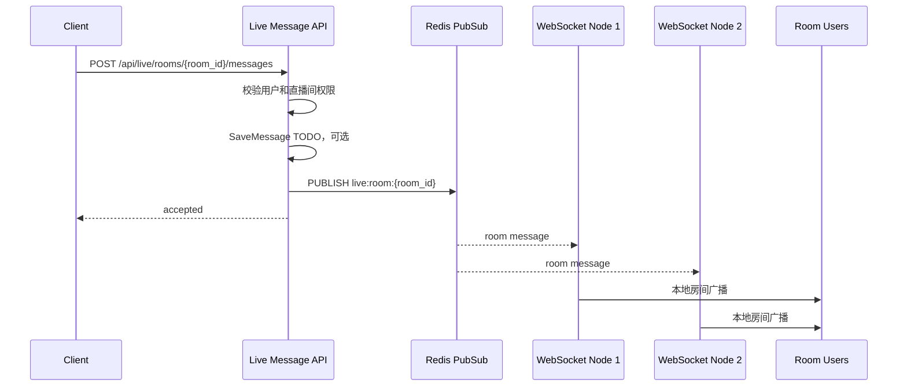

# 分布式 WebSocket 消息分发实现文档

## 1. 文档目标

本文档用于设计并实现一套基于 **Golang + Redis + gRPC + Go Gateway** 的分布式 WebSocket 消息分发系统。

系统需要支持：

```text
1. 多 WebSocket 节点横向扩展
2. Go Gateway 根据用户和节点状态分配 WebSocket endpoint
3. Nginx 负责 HTTP / WebSocket 入口转发
4. Redis 维护节点状态、用户连接路由、多端登录、ACK 临时状态
5. gRPC 负责 Message API 到 WebSocket Node 的内部精准推送
6. 支持单聊、中小群聊、系统通知
7. 支持直播间超大规模广播
8. 支持客户端 ACK
9. 支持多端登录
10. 消息下库逻辑暂时留空，但需要预留接口
11. 代码尽量抽象，业务层不直接依赖 gRPC、Redis Pub/Sub、Redis Stream、Kafka 等具体实现
```

---

## 2. 总体架构

推荐第一版架构：

```text
Nginx + Go Gateway + Message API + WebSocket Node + Redis + gRPC
```

整体职责：

| 模块             | 职责                                             |
| -------------- | ---------------------------------------------- |
| Nginx          | HTTP / WebSocket 入口代理                          |
| Go Gateway     | 给用户分配 WebSocket endpoint                       |
| Message API    | HTTP 发消息入口，查询路由，调用消息发送接口                       |
| WebSocket Node | 维护用户长连接，接收 gRPC 推送，执行本地 WebSocket 推送           |
| Redis          | 维护 endpoint 状态、连接路由、多端连接、ACK 临时状态、直播间状态        |
| gRPC           | Message API 到 WebSocket Node 的内部推送协议           |
| Sender 抽象层     | 屏蔽 gRPC、Redis Pub/Sub、Redis Stream、Kafka 等具体实现 |
| MessageStore   | 消息下库接口，当前暂时留空                                  |

---

## 3. 架构图



---

## 4. 服务模块说明

### 4.1 Go Gateway

Go Gateway 负责给用户分配 WebSocket endpoint。

职责：

```text
1. 接收客户端 /api/ws/route 请求
2. 解析 token，获取 user_id
3. 查询 Redis 中可用 WebSocket endpoint
4. 根据节点状态、连接数、最近连接节点选择 endpoint
5. 生成 route_token
6. 返回 ws_url 给客户端
```

Go Gateway 只负责分配，不负责长期代理 WebSocket 连接。

---

### 4.2 Nginx

Nginx 负责入口转发。

职责：

```text
1. 转发 /api/ws/route 到 Go Gateway
2. 转发 /api/messages/* 到 Message API
3. 转发 /ws/{endpoint_id} 到对应 WebSocket Node
4. 处理 WebSocket Upgrade
5. 处理 TLS、日志、限流等通用能力
```

Nginx 不负责用户分配逻辑。

---

### 4.3 Message API

Message API 是消息发送入口。

职责：

```text
1. 接收 HTTP 发消息请求
2. 校验 token 和业务权限
3. 生成或校验 message_id
4. 调用 MessageStore 保存消息，当前逻辑暂时留空
5. 查询 Redis 中的用户连接路由
6. 调用 MessageSender 发送消息
7. 返回 HTTP accepted
```

---

### 4.4 WebSocket Node

WebSocket Node 维护用户长连接。

职责：

```text
1. 接收客户端 WebSocket 连接
2. 校验 route_token
3. 维护本地 conn_id -> WebSocket 连接
4. 将连接路由写入 Redis
5. 定时上报 endpoint 心跳和连接数
6. 接收 gRPC PushToConns 请求
7. 推送消息到本地连接
8. 接收客户端 ACK
9. 写入 ACK 状态到 Redis
10. 维护直播间本地 room hub
```

---

## 5. 客户端连接流程

客户端不要直接连接固定 WebSocket 地址。

正确流程：

```text
1. 客户端请求 Go Gateway 获取 endpoint
2. Go Gateway 返回 ws_url
3. 客户端连接 ws_url
4. Nginx 根据路径转发到指定 WebSocket Node
5. WebSocket Node 校验 route_token
6. WebSocket Node 写入 Redis 连接路由
```

时序图：



---

## 6. Go Gateway 端点分配设计

### 6.1 分配接口

```http
GET /api/ws/route
Authorization: Bearer <token>
```

返回：

```json
{
  "endpoint_id": "ws-node-2",
  "ws_url": "wss://example.com/ws/ws-node-2?route_token=xxx",
  "expires_in": 30
}
```

客户端随后连接：

```text
wss://example.com/ws/ws-node-2?route_token=xxx
```

---

### 6.2 endpoint 选择规则

第一版推荐规则：

```text
1. endpoint.status 必须是 online
2. endpoint 不能处于 draining
3. endpoint.conn_count < endpoint.max_conn
4. 如果用户最近连接过某 endpoint，并且该 endpoint 可用，优先使用
5. 否则选择 conn_count / max_conn 最小的 endpoint
```

示例：

```text
ws-node-1: 12000 / 50000 = 0.24
ws-node-2:  8000 / 50000 = 0.16
ws-node-3: 20000 / 50000 = 0.40
```

选择：

```text
ws-node-2
```

---

### 6.3 Go Gateway 伪代码

```go
type Endpoint struct {
    ID        string
    Status    string
    WSPath    string
    WSAddr    string
    GRPCAddr  string
    ConnCount int64
    MaxConn   int64
    UpdatedAt int64
}

func SelectEndpoint(ctx context.Context, userID string) (*Endpoint, error) {
    lastEndpointID, _ := routeResolver.GetLastEndpoint(ctx, userID)

    if lastEndpointID != "" {
        ep, err := endpointRepo.GetEndpoint(ctx, lastEndpointID)
        if err == nil && IsEndpointAvailable(ep) {
            return ep, nil
        }
    }

    endpoints, err := endpointRepo.ListEndpoints(ctx)
    if err != nil {
        return nil, err
    }

    var selected *Endpoint
    var bestScore float64 = 999999

    for _, ep := range endpoints {
        if !IsEndpointAvailable(ep) {
            continue
        }

        score := float64(ep.ConnCount) / float64(ep.MaxConn)
        if selected == nil || score < bestScore {
            selected = ep
            bestScore = score
        }
    }

    if selected == nil {
        return nil, errors.New("no available websocket endpoint")
    }

    _ = routeResolver.SetLastEndpoint(ctx, userID, selected.ID, 10*time.Minute)

    return selected, nil
}

func IsEndpointAvailable(ep *Endpoint) bool {
    if ep == nil {
        return false
    }

    if ep.Status != "online" {
        return false
    }

    if ep.ConnCount >= ep.MaxConn {
        return false
    }

    if time.Now().Unix()-ep.UpdatedAt > 60 {
        return false
    }

    return true
}
```

---

## 7. Redis Key 设计

### 7.1 WebSocket endpoint 列表

```text
ws:endpoints
```

类型：Set

示例：

```text
ws-node-1
ws-node-2
ws-node-3
```

---

### 7.2 WebSocket endpoint 详情

```text
ws:endpoint:{endpoint_id}
```

类型：String，值为 JSON；Redis 模式下带连接路由 TTL，由节点心跳刷新。

示例：

```text
endpoint_id = ws-node-1
status      = online
ws_path     = /ws/ws-node-1
ws_addr     = 10.0.0.11:8081
grpc_addr   = 10.0.0.11:9001
conn_count  = 12000
max_conn    = 50000
updated_at  = 1720000000
```

说明：

```text
1. WebSocket Node 启动后写入该 Key
2. WebSocket Node 每 10 到 20 秒刷新一次
3. TTL 推荐 60 秒
4. Gateway 判断 updated_at 是否过期
```

---

### 7.3 用户多端连接

一个用户可以有多个连接。

```text
ws:user:{user_id}:conns
```

类型：Set

示例：

```text
conn_1001_ios
conn_1001_web
conn_1001_android
```

---

### 7.4 单个连接详情

```text
ws:conn:{conn_id}
```

类型：Hash

示例：

```text
conn_id     = conn_1001_ios
user_id     = 1001
endpoint_id = ws-node-2
device_id   = ios_abc
platform    = ios
grpc_addr   = 10.0.0.12:9001
created_at  = 1720000000
updated_at  = 1720000000
```

---

### 7.5 节点连接索引

```text
ws:endpoint:{endpoint_id}:conns
```

类型：Set

示例：

```text
conn_1001_ios
conn_1002_web
conn_1003_android
```

用于节点关闭时批量清理 Redis 路由。

---

### 7.6 用户最近连接 endpoint

```text
route:last_endpoint:{user_id}
```

类型：String

示例：

```text
ws-node-2
```

TTL 推荐：

```text
600 秒
```

用于用户短时间断线重连时优先回到原 WebSocket Node。

---

### 7.7 ACK 状态

待 ACK 连接：

```text
ack:msg:{message_id}:pending
```

类型：Set

已 ACK 连接：

```text
ack:msg:{message_id}:done
```

类型：Set

失败连接：

```text
ack:msg:{message_id}:failed
```

类型：Set

说明：pending / done / failed 都是临时状态，当前实现保留 24 小时；pending 另有 `ack:pending:index` 用于超时扫描。

TTL 推荐：

```text
86400 秒
```

---

### 7.8 直播间相关 Key

| Key                                | 类型              | 用途                          |
| ---------------------------------- | --------------- | --------------------------- |
| `live:room:{room_id}:nodes`        | Sorted Set      | 节点独立过期分数保存当前直播间承载节点      |
| `live:node:{endpoint_id}:rooms`    | Set             | 当前节点承载了哪些直播间                |
| `live:room:{room_id}:stats`        | Hash            | 直播间统计信息                     |
| `live:room:{room_id}:mute_users`   | Set             | 直播间禁言用户                     |
| `live:room:{room_id}:online_count` | String          | 直播间在线人数，允许近似                |
| `live:room:{room_id}`              | Pub/Sub Channel | 高频低价值直播间消息                  |
| `stream:live:room:{room_id}`       | Stream          | 重要直播间消息                     |

---

## 8. WebSocket Node 注册与心跳

### 8.1 节点启动注册

WebSocket Node 启动时写入：

```text
SADD ws:endpoints ws-node-1

HSET ws:endpoint:ws-node-1
  endpoint_id ws-node-1
  status online
  ws_path /ws/ws-node-1
  ws_addr 10.0.0.11:8081
  grpc_addr 10.0.0.11:9001
  conn_count 0
  max_conn 50000
  updated_at 1720000000

EXPIRE ws:endpoint:ws-node-1 60
```

---

### 8.2 节点心跳

每 10 到 20 秒刷新：

```text
HSET ws:endpoint:{endpoint_id}
  status online
  conn_count 当前连接数
  updated_at 当前时间戳

EXPIRE ws:endpoint:{endpoint_id} 60
```

---

### 8.3 节点关闭流程

节点关闭前必须进入 draining 状态。

```text
1. 设置 ws:endpoint:{endpoint_id}.status = draining
2. Gateway 不再分配新连接到该节点
3. 等待已有连接自然断开，或主动通知客户端重连
4. 清理该节点上的连接路由
5. 删除 endpoint 状态
```

Redis 清理逻辑：

```text
SMEMBERS ws:endpoint:{endpoint_id}:conns

对每个 conn_id：
  HGET ws:conn:{conn_id} user_id
  SREM ws:user:{user_id}:conns conn_id
  DEL ws:conn:{conn_id}

DEL ws:endpoint:{endpoint_id}:conns
DEL ws:endpoint:{endpoint_id}
SREM ws:endpoints endpoint_id
```

---

## 9. 多端登录设计

系统默认支持多端登录。

一个用户可能同时在线：

```text
user_id = 1001

conn_1001_ios      -> ws-node-1
conn_1001_web      -> ws-node-2
conn_1001_android  -> ws-node-2
```

推送策略：

| 消息类型     | 推送策略            |
| -------- | --------------- |
| 聊天消息     | 默认推送所有在线端       |
| 系统通知     | 默认推送所有在线端       |
| 设备专属消息   | 只推送指定 device_id |
| 直播间消息    | 只推送加入当前直播间的连接   |
| 后台强制单端登录 | 后续扩展            |

单聊推送流程：

```text
1. 查询 ws:user:{user_id}:conns
2. 得到多个 conn_id
3. 查询每个 conn_id 所在 endpoint
4. 按 endpoint_id 分组
5. 每个 endpoint 调用一次 gRPC PushToConns
```

---

## 10. HTTP 发消息流程

### 10.1 单聊接口

```http
POST /api/messages/single
Authorization: Bearer <token>
Content-Type: application/json
```

请求：

```json
{
  "message_id": "msg_100001",
  "to_user_id": "1002",
  "content": {
    "type": "text",
    "text": "hello"
  }
}
```

处理流程：

```text
1. Message API 校验 token
2. 校验发送权限
3. 生成或校验 message_id
4. 调用 MessageStore.SaveMessage，当前实现留空
5. 查询 ws:user:{to_user_id}:conns
6. 按 endpoint_id 分组连接
7. 调用 MessageSender.Send
8. Sender 使用 gRPC 推送到对应 WebSocket Node
9. WebSocket Node 写入本地连接发送队列
10. Message API 返回 accepted
11. 客户端收到消息后通过 WebSocket 返回 ACK
```

返回：

```json
{
  "message_id": "msg_100001",
  "status": "accepted"
}
```

说明：

```text
accepted 只代表服务端已经接受消息请求，不代表目标客户端已经收到。
```

---

## 11. ACK 机制设计

ACK 分三层：

| ACK 类型     | 说明                           |
| ---------- | ---------------------------- |
| HTTP ACK   | Message API 已接受请求            |
| Node ACK   | WebSocket Node 已接受 gRPC 推送任务 |
| Client ACK | 客户端确认收到消息                    |

---

### 11.1 HTTP ACK

Message API 返回：

```json
{
  "message_id": "msg_100001",
  "status": "accepted"
}
```

说明：

```text
HTTP ACK 只代表服务端接收请求成功。
不代表目标用户在线。
不代表 WebSocket Node 已推送成功。
不代表客户端已收到。
```

---

### 11.2 Node ACK

Message API 调用 WebSocket Node：

```text
PushToConns(conn_ids, message)
```

WebSocket Node 返回：

```json
{
  "accepted": true,
  "accepted_conn_ids": ["conn_1001_ios"],
  "failed_conn_ids": []
}
```

说明：

```text
Node ACK 只代表 WebSocket Node 已接收推送任务，并写入本地发送队列。
不代表客户端已经收到。
```

---

### 11.3 Client ACK

服务端推送消息：

```json
{
  "c": "socket_server",
  "m": "message",
  "data": {
    "message_id": "msg_100001",
    "ack_required": true,
    "payload": {
      "type": "text",
      "text": "hello"
    }
  }
}
```

客户端收到后回复：

```json
{
  "c": "socket_server",
  "m": "ack",
  "data": {
    "message_id": "msg_100001"
  }
}
```

WebSocket Node 收到 ACK 后写 Redis：

```text
SADD ack:msg:{msg_100001}:done conn_1001_ios
SREM ack:msg:{msg_100001}:pending conn_1001_ios
```

---

### 11.4 ACK 超时重试

推荐配置：

```text
ack_timeout = 5s
max_retry = 2
ack_redis_ttl = 86400s
```

流程：

```text
1. WebSocket Node 将消息写入连接发送队列
2. 如果 ack_required = true，将 conn_id 写入 pending
3. 等待客户端 ACK
4. 超时未 ACK，则重试推送
5. 超过 max_retry 仍未 ACK，写入 failed
```

注意：

```text
当前消息下库逻辑暂时留空，因此 ACK 重试只保证在线连接的短期重试。
如果后续需要离线消息、消息漫游、长期补发，必须补充消息表和离线消息逻辑。
```

---

### 11.5 多端 ACK 规则

推荐第一版：

```text
服务端内部按 conn_id 记录 ACK。
业务展示时按 user_id 聚合 ACK。
```

两种模式：

| 模式      | 说明                   | 适用       |
| ------- | -------------------- | -------- |
| 按连接 ACK | 每个 conn_id 都需要 ACK   | 精确确认每个设备 |
| 按用户 ACK | 任意一个在线端 ACK 即认为用户已收到 | 普通聊天消息   |

第一版建议：

```text
Redis 内部按 conn_id 记录 ACK。
业务上可以按 user_id 聚合展示。
```

---

## 12. gRPC 接口设计

```proto
syntax = "proto3";

package websocket.v1;

option go_package = "app/pb/websocket;websocketpb";

message PushMessage {
  string message_id = 1;
  string from_user_id = 2;
  string biz_type = 3; // single / group / live / system
  bytes payload = 4;
  bool ack_required = 5;
  int64 created_at = 6;
  repeated string to_user_ids = 7;
  repeated string conn_ids = 8;
  string group_id = 9;
  string room_id = 10;
}

message PushToConnsRequest {
  repeated string conn_ids = 1;
  PushMessage message = 2;
}

message PushToUsersRequest {
  repeated string user_ids = 1;
  PushMessage message = 2;
}

message PushResponse {
  bool accepted = 1;
  repeated string accepted_conn_ids = 2;
  repeated string failed_conn_ids = 3;
  string reason = 4;
}

message HealthRequest {
  string endpoint_id = 1;
}

message HealthResponse {
  string endpoint_id = 1;
  string status = 2; // online / draining / offline
  int64 conn_count = 3;
}

service WebSocketPushService {
  rpc PushToConns(PushToConnsRequest) returns (PushResponse);
  rpc PushToUsers(PushToUsersRequest) returns (PushResponse);
  rpc Health(HealthRequest) returns (HealthResponse);
}
```

推荐使用：

```text
单聊、多端推送：PushToConns
中小群推送：PushToConns
只知道 user_id 时：PushToUsers
健康检查：Health
```

---

## 13. 单聊消息分发流程



---

## 14. 普通群聊消息分发流程

第一版普通群聊不引入 Kafka。

普通群聊使用：

```text
Redis 路由查询 + gRPC 批量推送
```

流程：

```text
1. Message API 接收群消息
2. 校验发送人是否在群内
3. SaveMessage TODO
4. 查询群成员列表
5. 查询在线成员连接
6. 按 endpoint_id 分组
7. 每个 endpoint 调用一次 gRPC PushToConns
8. WebSocket Node 推送给本机连接
9. 客户端 ACK
10. WebSocket Node 记录 ACK
```

示例：

```text
group_id = 888

在线成员分布：

ws-node-1:
  conn_1001_ios
  conn_1002_web

ws-node-2:
  conn_1003_ios
  conn_1004_android
```

Message API 发起两次 gRPC：

```text
PushToConns(ws-node-1, [conn_1001_ios, conn_1002_web])
PushToConns(ws-node-2, [conn_1003_ios, conn_1004_android])
```

说明：

```text
该方案适合中小群。
如果后期出现大群、直播间、系统广播，再升级 Redis Stream 或 Kafka。
```

---

## 15. 直播间超大规模广播

直播间广播和普通群聊不同。

普通群聊可以按用户连接查询后分组推送。

直播间人数可能很大，不能每条消息都按用户枚举，也不建议对每个用户做客户端 ACK。

直播间推荐使用：

```text
Redis Pub/Sub + WebSocket Node 本地房间连接表
```

重要通知使用：

```text
Redis Stream + WebSocket Node 消费 + 本地广播
```

---

### 15.1 直播间消息分类

| 消息类型    | 示例                | 推荐方案            | ACK        |
| ------- | ----------------- | --------------- | ---------- |
| 高频低价值消息 | 弹幕、点赞、进场提示、在线人数变化 | Redis Pub/Sub   | 不需要        |
| 中频重要消息  | 主播开播、关播、禁言、系统公告   | Redis Stream    | Node 级 ACK |
| 高价值业务消息 | 订单、支付、中奖、风控通知     | 业务消息链路          | 业务 ACK     |
| 普通群聊消息  | 群聊文本、图片           | Redis 路由 + gRPC | 客户端 ACK    |

---

### 15.2 直播间连接模型

WebSocket Node 本地维护：

```text
room_id -> conn_id list
```

示例：

```text
room_888:
  conn_1001_ios
  conn_1002_web
  conn_1003_android
```

用户进入直播间时：

```text
1. 客户端通过 WebSocket 发送 join_room
2. WebSocket Node 校验用户权限
3. WebSocket Node 将 conn_id 加入本地 RoomHub
4. WebSocket Node 在 Redis 标记本节点正在承载该直播间
```

客户端消息：

```json
{
  "c": "socket_server",
  "m": "join_room",
  "data": {
    "room_id": "room_888"
  }
}
```

Redis 记录：

```text
SADD live:room:{room_888}:nodes ws-node-1
SADD live:node:{ws-node-1}:rooms room_888
```

---

### 15.3 直播间弹幕广播流程



Redis Channel：

```text
live:room:{room_id}
```

示例：

```text
PUBLISH live:room:{room_888} '{"message_id":"msg_100001","type":"danmu","text":"hello"}'
```

WebSocket Node 只订阅自己有用户在线的直播间。

---

### 15.4 为什么直播间不能按用户 gRPC 推送

不建议这样：

```text
Live API
  ↓
查询直播间所有用户
  ↓
查询每个用户连接
  ↓
按 endpoint 分组
  ↓
gRPC 推送给所有 conn_id
```

原因：

```text
1. 每条弹幕都要查询大量用户
2. Redis 路由查询压力过大
3. Message API 扇出压力过大
4. 直播间人数越多，接口越慢
5. 不适合高频消息
```

正确方式：

```text
Live API 只发布一条 room message。
所有承载该 room 的 WebSocket Node 收到消息。
WebSocket Node 在本地向该 room 的连接广播。
```

---

### 15.5 重要直播间消息使用 Redis Stream

重要消息包括：

```text
1. 主播开播
2. 主播关播
3. 系统公告
4. 管理员禁言
5. 商品上架
6. 直播间状态变更
```

Stream Key：

```text
stream:live:room:{room_id}
```

示例：

```text
XADD stream:live:room:{room_888} MAXLEN ~ 10000 *
  message_id msg_100001
  room_id room_888
  type system_notice
  payload '{"text":"系统公告"}'
  created_at 1720000000
```

说明：

```text
Redis Stream 只做 Node 级可靠投递。
不对直播间内每个用户做客户端 ACK。
```

---

### 15.6 直播间本地广播实现

```go
type RoomHub struct {
    rooms map[string]map[string]*Client
}

type Client struct {
    ConnID string
    UserID string
    Send   chan []byte
}

func (h *RoomHub) Broadcast(roomID string, payload []byte) {
    clients := h.rooms[roomID]

    for connID, client := range clients {
        select {
        case client.Send <- payload:
        default:
            // 写队列满，说明客户端消费慢
            // 低价值消息可以丢弃，或者关闭慢连接
            h.Remove(roomID, connID)
        }
    }
}
```

低价值消息：

```text
弹幕、点赞、进场提示，客户端写队列满时可以丢弃。
```

重要消息：

```text
系统公告、商品上架，不建议仅依赖广播。
客户端可通过接口重新拉取直播间状态。
```

---

### 15.7 直播间降级策略

| 场景                 | 降级方式                |
| ------------------ | ------------------- |
| 弹幕过多               | 服务端限频、合并、丢弃低优先级弹幕   |
| 点赞过多               | 聚合计数后每 1 秒推一次       |
| 进场提示过多             | 合并为“多人进入直播间”        |
| 在线人数变化频繁           | 定时推送，不逐次推送          |
| 客户端写队列满            | 丢弃低价值消息             |
| Redis Pub/Sub 压力高  | 按房间限流               |
| WebSocket Node 压力高 | Gateway 不再分配新连接到该节点 |

---

### 15.8 直播间 ACK 规则

直播间广播默认不做客户端 ACK。

推荐规则：

```text
1. 弹幕、点赞、进场提示：不 ACK
2. 系统公告：Node ACK
3. 商品上架：Node ACK + 客户端主动拉取最新商品列表
4. 中奖、支付、订单：不走普通直播间广播，必须走业务消息链路
```

中奖消息示例：

```text
不建议仅通过 live:room:{room_id} 广播中奖结果。

正确方式：
1. 中奖结果下库
2. 给中奖用户发送单聊或系统通知
3. 客户端通过接口查询中奖记录
```

---

### 15.9 直播间和群聊的区别

| 对比项       | 普通群聊            | 直播间                     |
| --------- | --------------- | ----------------------- |
| 成员关系      | 相对稳定            | 进出频繁                    |
| 消息可靠性     | 较高              | 分类型处理                   |
| 是否枚举用户    | 可以              | 不建议                     |
| 是否客户端 ACK | 推荐              | 高频消息不 ACK               |
| 分发方式      | Redis 路由 + gRPC | Pub/Sub / Stream + 本地广播 |
| 离线补发      | 后续可做            | 一般不补发弹幕                 |

最终规则：

```text
普通群聊：按用户连接路由推送。
直播间：按 room_id 广播，WebSocket Node 本地 fanout。
```

---

## 16. 消息下库逻辑占位

当前文档只设计实时分发链路。

消息下库逻辑暂时留空，但必须预留接口。

```go
type MessageStore interface {
    SaveMessage(ctx context.Context, msg *Message) error
    SaveDeliveryStatus(ctx context.Context, messageID string, userID string, connID string, status string) error
    SaveClientAck(ctx context.Context, messageID string, userID string, connID string, ackType string) error
}
```

第一版空实现：

```go
type EmptyMessageStore struct{}

func (s *EmptyMessageStore) SaveMessage(ctx context.Context, msg *Message) error {
    return nil
}

func (s *EmptyMessageStore) SaveDeliveryStatus(ctx context.Context, messageID string, userID string, connID string, status string) error {
    return nil
}

func (s *EmptyMessageStore) SaveClientAck(ctx context.Context, messageID string, userID string, connID string, ackType string) error {
    return nil
}
```

后续可替换为：

```text
MySQL / PostgreSQL / MongoDB / ClickHouse
```

---

## 17. 代码规范与抽象设计要求

为了方便后期扩展，项目代码需要面向接口编程。

业务层不允许直接依赖：

```text
1. gRPC Client
2. Redis Client
3. Redis Pub/Sub
4. Redis Stream
5. Kafka Producer
6. 具体 Redis Key
```

业务层只依赖抽象接口。

核心原则：

```text
1. 业务层依赖接口，不依赖具体实现
2. gRPC、Redis Pub/Sub、Redis Stream、Kafka 都是 Sender 的不同实现
3. 单聊、小群、直播间、系统通知只选择不同 Sender，不改业务主流程
4. 新增发送方式时，只新增实现类，不修改核心业务代码
5. Redis Key 必须统一管理
6. 消息下库、ACK、路由查询、消息发送需要拆成独立模块
```

---

## 18. 消息发送接口抽象

统一定义消息发送接口：

```go
package sender

import "context"

type Message struct {
    MessageID   string
    FromUserID  string
    ToUserIDs   []string
    ConnIDs     []string
    GroupID     string
    RoomID      string
    BizType     string // single / group / live_danmu / live_notice / system
    Payload     []byte
    AckRequired bool
    CreatedAt   int64
}

type SendResult struct {
    Accepted        bool
    AcceptedConnIDs []string
    FailedConnIDs   []string
    Reason          string
}

type MessageSender interface {
    Send(ctx context.Context, msg *Message) (*SendResult, error)
}
```

说明：

```text
MessageSender 是所有消息发送方式的统一接口。
业务层只调用 MessageSender.Send。
具体使用 gRPC、Redis Pub/Sub、Redis Stream 或 Kafka，由实现类决定。
```

---

## 19. gRPC Sender 实现

gRPC Sender 用于单聊、中小群、指定用户系统通知。

```go
package sender

import "context"

type GRPCSender struct {
    router RouteResolver
    client PushClient
}

func NewGRPCSender(router RouteResolver, client PushClient) *GRPCSender {
    return &GRPCSender{
        router: router,
        client: client,
    }
}

func (s *GRPCSender) Send(ctx context.Context, msg *Message) (*SendResult, error) {
    endpointGroups, err := s.router.GroupConnsByEndpoint(ctx, msg.ConnIDs)
    if err != nil {
        return nil, err
    }

    result := &SendResult{
        Accepted: true,
    }

    for endpointID, connIDs := range endpointGroups {
        resp, err := s.client.PushToConns(ctx, endpointID, connIDs, msg)
        if err != nil {
            result.Accepted = false
            result.FailedConnIDs = append(result.FailedConnIDs, connIDs...)
            continue
        }

        result.AcceptedConnIDs = append(result.AcceptedConnIDs, resp.AcceptedConnIDs...)
        result.FailedConnIDs = append(result.FailedConnIDs, resp.FailedConnIDs...)
    }

    return result, nil
}
```

适用场景：

```text
1. 单聊消息
2. 中小群消息
3. 指定用户系统通知
4. 需要客户端 ACK 的消息
```

---

## 20. Redis Pub/Sub Sender 实现

Redis Pub/Sub Sender 用于直播间弹幕、点赞、进场提示等高频低价值消息。

```go
package sender

import (
    "context"
    "encoding/json"
)

type RedisPubSubSender struct {
    redis RedisClient
}

func NewRedisPubSubSender(redis RedisClient) *RedisPubSubSender {
    return &RedisPubSubSender{
        redis: redis,
    }
}

func (s *RedisPubSubSender) Send(ctx context.Context, msg *Message) (*SendResult, error) {
    channel := LiveRoomChannel(msg.RoomID)

    body, err := domain.MarshalClientMessage(msg)
    if err != nil {
        return nil, err
    }

    if err := s.redis.Publish(ctx, channel, body); err != nil {
        return nil, err
    }

    return &SendResult{
        Accepted: true,
    }, nil
}
```

适用场景：

```text
1. 直播间弹幕
2. 点赞
3. 用户进场提示
4. 在线人数变化
5. 允许少量丢失的实时消息
```

注意：

```text
Redis Pub/Sub 不保证消息可靠投递。
WebSocket Node 重启或断开订阅期间，消息可能丢失。
不要用于订单、支付、中奖、重要系统通知。
```

---

## 21. Redis Stream Sender 实现

Redis Stream Sender 用于直播间公告、系统广播、重要状态变更。

```go
package sender

import (
    "context"
    "encoding/json"
)

type RedisStreamSender struct {
    redis RedisClient
}

func NewRedisStreamSender(redis RedisClient) *RedisStreamSender {
    return &RedisStreamSender{
        redis: redis,
    }
}

func (s *RedisStreamSender) Send(ctx context.Context, msg *Message) (*SendResult, error) {
    streamKey := LiveRoomStream(msg.RoomID)

    body, err := domain.MarshalClientMessage(msg)
    if err != nil {
        return nil, err
    }

    if err := s.redis.XAdd(ctx, streamKey, map[string]interface{}{
        "message_id": msg.MessageID,
        "biz_type":   msg.BizType,
        "payload":    body,
        "created_at": msg.CreatedAt,
    }); err != nil {
        return nil, err
    }

    return &SendResult{
        Accepted: true,
    }, nil
}
```

适用场景：

```text
1. 直播间系统公告
2. 主播开播、关播
3. 商品上架
4. 管理员禁言
5. 直播间状态变更
6. 系统广播
```

---

## 22. Sender 选择器

业务层不直接 new 具体 Sender。

统一通过 SenderSelector 获取。

```go
package sender

import "context"

type SendMode string

const (
    SendModeGRPC        SendMode = "grpc"
    SendModeRedisPubSub SendMode = "redis_pubsub"
    SendModeRedisStream SendMode = "redis_stream"
)

type SenderSelector interface {
    Select(ctx context.Context, msg *Message) MessageSender
}

type DefaultSenderSelector struct {
    grpcSender        MessageSender
    redisPubSubSender MessageSender
    redisStreamSender MessageSender
}

func NewDefaultSenderSelector(
    grpcSender MessageSender,
    redisPubSubSender MessageSender,
    redisStreamSender MessageSender,
) *DefaultSenderSelector {
    return &DefaultSenderSelector{
        grpcSender:        grpcSender,
        redisPubSubSender: redisPubSubSender,
        redisStreamSender: redisStreamSender,
    }
}

func (s *DefaultSenderSelector) Select(ctx context.Context, msg *Message) MessageSender {
    switch msg.BizType {
    case "single":
        return s.grpcSender

    case "group":
        return s.grpcSender

    case "system_to_user":
        return s.grpcSender

    case "live_danmu":
        return s.redisPubSubSender

    case "live_like":
        return s.redisPubSubSender

    case "live_join":
        return s.redisPubSubSender

    case "live_notice":
        return s.redisStreamSender

    case "live_status":
        return s.redisStreamSender

    case "system_broadcast":
        return s.redisStreamSender

    default:
        return s.grpcSender
    }
}
```

---

## 23. Message Service 调用方式

MessageService 只依赖接口：

```go
package message

import (
    "context"
    "sender"
)

type MessageService struct {
    store          MessageStore
    routeResolver  RouteResolver
    senderSelector sender.SenderSelector
}

func NewMessageService(
    store MessageStore,
    routeResolver RouteResolver,
    senderSelector sender.SenderSelector,
) *MessageService {
    return &MessageService{
        store:          store,
        routeResolver:  routeResolver,
        senderSelector: senderSelector,
    }
}

func (s *MessageService) SendSingleMessage(ctx context.Context, msg *sender.Message) (*sender.SendResult, error) {
    if err := s.store.SaveMessage(ctx, msg); err != nil {
        return nil, err
    }

    connIDs, err := s.routeResolver.GetUserConnIDs(ctx, msg.ToUserIDs[0])
    if err != nil {
        return nil, err
    }

    msg.ConnIDs = connIDs
    msg.BizType = "single"
    msg.AckRequired = true

    selectedSender := s.senderSelector.Select(ctx, msg)

    return selectedSender.Send(ctx, msg)
}
```

直播间弹幕：

```go
func (s *MessageService) SendLiveDanmu(ctx context.Context, msg *sender.Message) (*sender.SendResult, error) {
    if err := s.store.SaveMessage(ctx, msg); err != nil {
        return nil, err
    }

    msg.BizType = "live_danmu"
    msg.AckRequired = false

    selectedSender := s.senderSelector.Select(ctx, msg)

    return selectedSender.Send(ctx, msg)
}
```

---

## 24. 路由查询接口抽象

业务层不能直接操作 Redis Key。

```go
package route

import "context"

type EndpointGroup map[string][]string

type RouteResolver interface {
    GetUserConnIDs(ctx context.Context, userID string) ([]string, error)
    GetUsersConnIDs(ctx context.Context, userIDs []string) ([]string, error)
    GetConnEndpoint(ctx context.Context, connID string) (string, error)
    GroupConnsByEndpoint(ctx context.Context, connIDs []string) (EndpointGroup, error)
    IsEndpointAvailable(ctx context.Context, endpointID string) (bool, error)
    GetLastEndpoint(ctx context.Context, userID string) (string, error)
    SetLastEndpoint(ctx context.Context, userID string, endpointID string, ttl time.Duration) error
}
```

Redis 实现示例：

```go
type RedisRouteResolver struct {
    redis RedisClient
}

func (r *RedisRouteResolver) GetUserConnIDs(ctx context.Context, userID string) ([]string, error) {
    key := rediskey.UserConnsKey(userID)
    return r.redis.SMembers(ctx, key)
}

func (r *RedisRouteResolver) GroupConnsByEndpoint(ctx context.Context, connIDs []string) (EndpointGroup, error) {
    groups := make(EndpointGroup)

    for _, connID := range connIDs {
        endpointID, err := r.GetConnEndpoint(ctx, connID)
        if err != nil {
            continue
        }

        groups[endpointID] = append(groups[endpointID], connID)
    }

    return groups, nil
}
```

---

## 25. ACK 接口抽象

ACK 逻辑独立管理。

```go
package ack

import "context"

type AckStore interface {
    AddPending(ctx context.Context, messageID string, connIDs []string) error
    MarkDone(ctx context.Context, messageID string, connID string) error
    MarkFailed(ctx context.Context, messageID string, connID string, reason string) error
    GetPending(ctx context.Context, messageID string) ([]string, error)
}
```

Redis 实现：

```go
type RedisAckStore struct {
    redis RedisClient
}

func (s *RedisAckStore) AddPending(ctx context.Context, messageID string, connIDs []string) error {
    pendingKey := rediskey.AckPendingKey(messageID)

    if err := s.redis.SAdd(ctx, pendingKey, connIDs...); err != nil {
        return err
    }

    return s.redis.Expire(ctx, pendingKey, AckTTL)
}

func (s *RedisAckStore) MarkDone(ctx context.Context, messageID string, connID string) error {
    pendingKey := rediskey.AckPendingKey(messageID)
    doneKey := rediskey.AckDoneKey(messageID)

    if err := s.redis.SRem(ctx, pendingKey, connID); err != nil {
        return err
    }

    if err := s.redis.SAdd(ctx, doneKey, connID); err != nil {
        return err
    }

    return s.redis.Expire(ctx, doneKey, AckTTL)
}
```

---

## 26. Redis Key 统一管理

所有 Redis Key 必须集中定义。

禁止在 handler、service、sender 中手写 Redis Key。

```go
package rediskey

import "fmt"

func UserConnsKey(userID string) string {
    return fmt.Sprintf("ws:user:%s:conns", userID)
}

func ConnKey(connID string) string {
    return fmt.Sprintf("ws:conn:%s", connID)
}

func EndpointKey(endpointID string) string {
    return fmt.Sprintf("ws:endpoint:%s", endpointID)
}

func EndpointConnsKey(endpointID string) string {
    return fmt.Sprintf("ws:endpoint:%s:conns", endpointID)
}

func LastEndpointKey(userID string) string {
    return fmt.Sprintf("route:last_endpoint:%s", userID)
}

func AckPendingKey(messageID string) string {
    return fmt.Sprintf("ack:msg:%s:pending", messageID)
}

func AckDoneKey(messageID string) string {
    return fmt.Sprintf("ack:msg:%s:done", messageID)
}

func AckFailedKey(messageID string) string {
    return fmt.Sprintf("ack:msg:%s:failed", messageID)
}

func LiveRoomChannel(roomID string) string {
    return fmt.Sprintf("live:room:%s", roomID)
}

func LiveRoomStream(roomID string) string {
    return fmt.Sprintf("stream:live:room:%s", roomID)
}

func LiveRoomNodesKey(roomID string) string {
    return fmt.Sprintf("live:room:%s:nodes", roomID)
}

func LiveNodeRoomsKey(endpointID string) string {
    return fmt.Sprintf("live:node:%s:rooms", endpointID)
}
```

要求：

```text
1. 禁止业务代码直接拼 Redis Key
2. Redis Key 必须统一从 rediskey 包获取
3. 后期修改 Key 规则时，只修改 rediskey 包
```

---

## 27. Nginx 配置示例

```nginx
map $http_upgrade $connection_upgrade {
    default upgrade;
    ''      close;
}

upstream gateway_nodes {
    server 10.0.0.10:7000;
}

upstream api_nodes {
    server 10.0.0.20:7100;
}

upstream ws_node_1 {
    server 10.0.0.11:8081;
}

upstream ws_node_2 {
    server 10.0.0.12:8081;
}

upstream ws_node_3 {
    server 10.0.0.13:8081;
}

server {
    listen 443 ssl;
    server_name example.com;

    location /api/ws/route {
        proxy_pass http://gateway_nodes;
    }

    location /api/ {
        proxy_pass http://api_nodes;
    }

    location /ws/ws-node-1 {
        proxy_pass http://ws_node_1;
        proxy_http_version 1.1;
        proxy_set_header Upgrade $http_upgrade;
        proxy_set_header Connection $connection_upgrade;
        proxy_read_timeout 3600s;
    }

    location /ws/ws-node-2 {
        proxy_pass http://ws_node_2;
        proxy_http_version 1.1;
        proxy_set_header Upgrade $http_upgrade;
        proxy_set_header Connection $connection_upgrade;
        proxy_read_timeout 3600s;
    }

    location /ws/ws-node-3 {
        proxy_pass http://ws_node_3;
        proxy_http_version 1.1;
        proxy_set_header Upgrade $http_upgrade;
        proxy_set_header Connection $connection_upgrade;
        proxy_read_timeout 3600s;
    }
}
```

说明：

```text
Go Gateway 决定用户连接哪个 endpoint。
Nginx 根据路径把连接转发到指定 WebSocket Node。
```

---

## 28. 推荐项目目录

```text
im-service/
├── cmd/
│   ├── gateway/
│   │   └── main.go
│   ├── message-api/
│   │   └── main.go
│   └── websocket-node/
│       └── main.go
├── internal/
│   ├── gateway/
│   │   ├── handler.go
│   │   ├── selector.go
│   │   └── route_token.go
│   ├── message/
│   │   ├── service.go
│   │   ├── handler.go
│   │   └── store.go
│   ├── sender/
│   │   ├── sender.go
│   │   ├── selector.go
│   │   ├── grpc_sender.go
│   │   ├── redis_pubsub_sender.go
│   │   └── redis_stream_sender.go
│   ├── route/
│   │   ├── resolver.go
│   │   └── redis_resolver.go
│   ├── ack/
│   │   ├── store.go
│   │   └── redis_store.go
│   ├── rediskey/
│   │   └── keys.go
│   ├── websocket/
│   │   ├── server.go
│   │   ├── conn.go
│   │   ├── hub.go
│   │   ├── room_hub.go
│   │   └── ack_handler.go
│   └── grpc/
│       ├── client.go
│       └── server.go
├── api/
│   └── proto/
│       └── websocket.proto
├── deploy/
│   ├── nginx.conf
│   ├── start.sh
│   ├── stop.sh
│   └── restart.sh
└── go.mod
```

---

## 29. 服务启动脚本设计

### 29.1 start.sh

```bash
#!/usr/bin/env bash

APP_NAME=$1
PORT=$2
GRPC_PORT=$3
ENDPOINT_ID=$4

mkdir -p logs runtime

nohup ./bin/${APP_NAME} \
  --port=${PORT} \
  --grpc-port=${GRPC_PORT} \
  --endpoint-id=${ENDPOINT_ID} \
  >> ./logs/${APP_NAME}-${ENDPOINT_ID}.log 2>&1 &

echo $! > ./runtime/${APP_NAME}-${ENDPOINT_ID}.pid

echo "${APP_NAME} ${ENDPOINT_ID} started"
```

---

### 29.2 stop.sh

```bash
#!/usr/bin/env bash

APP_NAME=$1
ENDPOINT_ID=$2

PID_FILE=./runtime/${APP_NAME}-${ENDPOINT_ID}.pid

if [ ! -f "$PID_FILE" ]; then
  echo "pid file not found"
  exit 0
fi

PID=$(cat $PID_FILE)

kill $PID
rm -f $PID_FILE

echo "${APP_NAME} ${ENDPOINT_ID} stopped"
```

---

### 29.3 restart.sh

```bash
#!/usr/bin/env bash

APP_NAME=$1
PORT=$2
GRPC_PORT=$3
ENDPOINT_ID=$4

./deploy/stop.sh ${APP_NAME} ${ENDPOINT_ID}
sleep 1
./deploy/start.sh ${APP_NAME} ${PORT} ${GRPC_PORT} ${ENDPOINT_ID}
```

---

## 30. 异常恢复与容错

### 30.1 WebSocket Node 异常退出

依赖 Redis TTL 自动过期。

处理方式：

```text
1. endpoint 心跳 `updated_at` 超过 Gateway 的 `heartbeat_timeout`
2. Gateway 不再分配新连接到该 endpoint
3. Message API 查询连接路由时发现 conn 已失效
4. 客户端断线后重新请求 Gateway 获取新 endpoint
```

---

### 30.2 gRPC 推送失败

处理方式：

```text
1. GRPCSender 记录 failed_conn_ids
2. 如果连接仍在线，可以短期重试
3. 如果 endpoint 不可用，清理相关连接路由
4. 如果消息需要长期补发，后续依赖消息表和离线消息逻辑
```

---

### 30.3 客户端 ACK 超时

处理方式：

```text
1. WebSocket Node 本地重试 max_retry 次
2. 仍未 ACK，写入 ack:msg:{message_id}:failed
3. 后续消息下库后，可同步写入消息投递状态表
```

---

### 30.4 Redis 短暂异常

处理方式：

```text
1. Gateway 无法分配 endpoint 时返回服务暂不可用
2. Message API 无法查询路由时返回发送失败或 accepted 后异步重试
3. WebSocket Node 本地连接继续保持
4. Redis 恢复后重新上报 endpoint 和连接状态
```

---

## 31. 性能优化建议

### 31.1 单聊和中小群

```text
1. 按 endpoint_id 分组后批量调用 gRPC
2. 不要每个用户调用一次 gRPC
3. Redis 查询连接时使用 pipeline
4. WebSocket Node 内部使用每个连接独立 send channel
5. 慢连接写队列满时断开或降级
```

---

### 31.2 直播间

```text
1. 不按用户枚举推送
2. 使用 room_id 维度广播
3. WebSocket Node 本地 fanout
4. 弹幕、点赞允许丢弃低优先级消息
5. 点赞、在线人数变化做聚合后定时推送
6. 超大规模后可将 Redis Pub/Sub / Stream 升级为 Kafka
```

---

### 31.3 ACK

```text
1. 普通聊天消息需要 ACK
2. 直播间高频消息不做客户端 ACK
3. Redis ACK Key 设置 TTL
4. ACK 写入可以异步批量处理
5. 后续下库后再持久化 ACK 状态
```

---

## 32. 后期扩展 Kafka 的方式

如果后期需要将直播间广播或大群消息升级为 Kafka，不需要修改业务层。

只需要新增 KafkaSender。

```go
type KafkaSender struct {
    producer KafkaProducer
}

func NewKafkaSender(producer KafkaProducer) *KafkaSender {
    return &KafkaSender{
        producer: producer,
    }
}

func (s *KafkaSender) Send(ctx context.Context, msg *Message) (*SendResult, error) {
    topic := ResolveKafkaTopic(msg)

    if err := s.producer.Publish(ctx, topic, msg); err != nil {
        return nil, err
    }

    return &SendResult{
        Accepted: true,
    }, nil
}
```

然后在 SenderSelector 中切换：

```go
case "live_danmu":
    return s.kafkaSender
```

业务代码不需要改。

---

## 33. 第一版实现范围

第一版需要实现：

```text
1. Go Gateway 分配 WebSocket endpoint
2. Nginx 按路径转发 WebSocket 连接
3. WebSocket Node 注册 endpoint 和连接路由
4. 支持同一用户多端登录
5. Message API 支持单聊
6. Message API 支持中小群 gRPC 批量推送
7. 支持客户端 received ACK
8. Redis 保存 ACK 临时状态
9. 消息下库接口预留，具体实现留空
10. 直播间弹幕、点赞、进场提示使用 Redis Pub/Sub
11. 直播间公告、状态变更使用 Redis Stream
12. WebSocket Node 本地维护 room_id -> conn_id 映射
13. 消息发送逻辑基于 MessageSender 接口抽象
```

第一版暂不处理：

```text
1. 离线消息补发
2. 消息长期存储
3. 消息漫游
4. 复杂已读回执
5. 大群 Kafka 削峰
6. 跨机房 WebSocket 调度
```

---

## 34. 最终结论

本项目第一版推荐：

```text
Nginx + Go Gateway + Message API + WebSocket Node + Redis + gRPC
```

核心规则：

```text
1. 用户分配逻辑放在 Go Gateway，不放在 Nginx
2. Nginx 只负责转发
3. Redis 负责 endpoint 状态、连接路由、多端连接、ACK 临时状态
4. 单聊和中小群使用 Redis 路由 + gRPC 推送
5. 直播间高频广播使用 Redis Pub/Sub
6. 直播间重要消息使用 Redis Stream
7. 客户端普通聊天消息必须 ACK
8. 直播间高频消息不做客户端 ACK
9. 消息下库逻辑暂时留空，但必须预留 MessageStore 接口
10. 发送逻辑必须抽象为 MessageSender 接口
11. 后期扩展 Kafka、RocketMQ、NATS 时，只新增 Sender 实现，不改业务主流程
```

一句话：

```text
业务层只关心“发送消息”，不关心消息最终是通过 gRPC、Redis Pub/Sub、Redis Stream 还是 Kafka 发出去。
```
